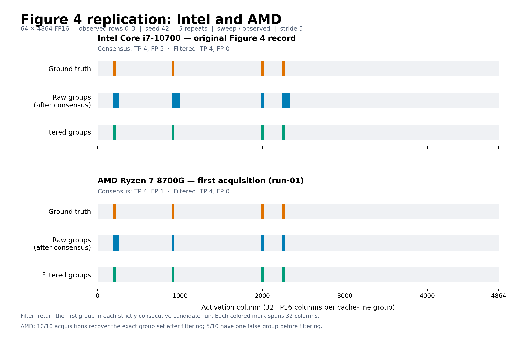

# AMD cache-recovery experiments

The controlled CPU Flush+Reload experiment recovers all four injected cache-line groups on an AMD Ryzen 7 8700G. All ten acquisitions matching the paper's Figure 4 settings have 100% precision and recall after the original neighboring-group filter. Five acquisitions have one false group after row consensus; the other five have none.

**[FINAL_RESULTS.txt](FINAL_RESULTS.txt) is the single consolidated results file for manuscript use.** It includes the matched Intel comparison, every AMD acquisition, controls, variability, calibration, numerical checks, spatial diagnostics, and four earlier supplemental configurations. Rates, denominators, settings, provenance, and limitations are explicit. It is generated from the archived measurements, not manually transcribed.



## Contents

| Path | Purpose |
| --- | --- |
| `FINAL_RESULTS.txt` | All final results and manuscript-ready interpretation, including supplemental experiments |
| `matched-figure4/amd/` | Ten complete AMD acquisitions, logs, and environment manifest from 2026-11-09 |
| `matched-figure4/intel-original/` | Exact copies of the upstream `prefill-four-rows` records (seed 42) |
| `matched-figure4/intel-reanalysis/` | Intel group scores recomputed using the same analyzer |
| `matched-figure4/comparison.{json,csv}` | Machine-readable matched comparison and verification details |
| `matched-figure4/figure4-*.{png,pdf,svg}` | Comparison and repeatability figures; vector formats can be used in a paper |
| `matched-figure4/REPORT.txt` | Detailed Chinese report for the matched experiment |
| `matched-figure4/run_matched.py` | Execute the unchanged upstream protocol, with all settings explicit |
| `matched-figure4/validate_and_plot.py` | Validate archived measurements and regenerate the matched plots |
| `supplementary-20261107/` | Four earlier CPU cache experiments with different settings, clearly separated from Figure 4 |
| `run_supplementary.py` | Re-execute those four configurations using their archived parameters |
| `summarize_final_results.py` | Verify all raw records and regenerate the consolidated TXT |
| `files.sha256.json` | SHA256 inventory for the published folder, excluding this inventory and caches |

## Protocol and code

The measurement implementation remains in the repository's [`prefill_flush_reload/`](../../prefill_flush_reload), [`flush_reload_native.c`](../../flush_reload_native.c), and [`flush_reload_test.py`](../../flush_reload_test.py). Its pinned baseline is commit `58cc1cc78f708c3a70c2f6cd969baa5f835ef957`; 17 file hashes are recorded in `matched-figure4/source-sha256.json`. No measurement kernels, timing primitives, thresholds, or decision rules were changed for AMD.

The matched protocol uses a 64 × 4864 FP16 activation matrix, hidden dimension 896, four injected columns, activation threshold 32, seed 42, observed rows 0–3, five repeats, stride 5, `sweep` probing, and `observed` flushing. It runs the full 64-row gather. The row hit fraction is 0.6 and group consensus fraction is 0.5. Each contiguous candidate run is filtered to its first group. The main result uses the consensus selector; control-adjusted scores are also retained.

The cache-hit timing cutoff is independently calibrated by the original code on each acquisition. It is not fixed to the same TSC count on different machines. This is a staged, single-process synthetic CPU experiment, not a real-LLM or NPU recovery result. Intel is the historical record associated with Figure 4, not a new Intel measurement. Historical Intel compiler and system-tuning metadata are unavailable.

`prefill-four-rows` (word `four`, seed 42) is the Figure 4 baseline. The upstream `prefill-4-rows` (digit `4`, seed 420) is a different experiment. The similarly named supplemental AMD run also has different settings; do not substitute either into the matched comparison.

## Rebuild the report and figures without measuring

From the repository root, with Python 3.9+ and Matplotlib installed:

```bash
python3 -B experiments/amd-cache-recovery/matched-figure4/validate_and_plot.py --source .
python3 -B experiments/amd-cache-recovery/summarize_final_results.py --source .
```

The first command verifies 100,320 matched records, including identical Intel/AMD probe order and labels. The second checks all 405,840 records across the matched and supplemental datasets, then generates `FINAL_RESULTS.txt`. Original CSV files are never rewritten. Regenerating plots may change rendering metadata and therefore file hashes.

## Collect new measurements

Use Linux x86-64 with F16C, RDTSCP, 64-byte cache lines, Python 3, and a C compiler. PyTorch, bitsandbytes installation, NPU drivers, and administrator privileges are not required for this experiment.

```bash
# Verify measurement-source hashes and inspect the planned commands first.
python3 experiments/amd-cache-recovery/matched-figure4/run_matched.py \
  --source . --output /tmp/amd-figure4-new --acquisitions 10 --dry-run

# The output directory must not already exist.
python3 experiments/amd-cache-recovery/matched-figure4/run_matched.py \
  --source . --output /tmp/amd-figure4-new --acquisitions 10

# Optional: reproduce the four different historical configurations.
python3 experiments/amd-cache-recovery/run_supplementary.py \
  --source . --output /tmp/amd-supplementary-new
```

The runner records the first acquisition as primary before starting. Every subsequent run and failure is retained; runs are not selected or replaced. New measurements are kept separate from this published dataset. CPU scheduling, frequency, compiler, and system load can change the measurements.

The archived acquisition script originally required the exact baseline Git HEAD. Its published wrapper accepts documentation/data commits by checking the same 17 source hashes, and adds a `--dry-run` option. Historical raw measurements and manifests are preserved byte-for-byte.

## Interpretation

AMD's first matched run has a higher raw probe FPR than the Intel record (9.36% versus 5.81%), but fewer false groups after consensus (one versus five). Both are exact after filtering. Across ten fixed-input AMD acquisitions, raw FPR ranges from 5.10% to 9.36%; all ten are exact after filtering. These observations establish portability for the tested synthetic input and show that probe-level noise and group-level errors are different metrics. They do not establish architecture-wide superiority or prove a particular prefetch mechanism.

Earlier supplemental runs vary the row range, flushing scope, probe stride, seed, and/or probe mode. They are descriptive supplementary results, not a controlled one-factor ablation or an extension of the matched sample size.
